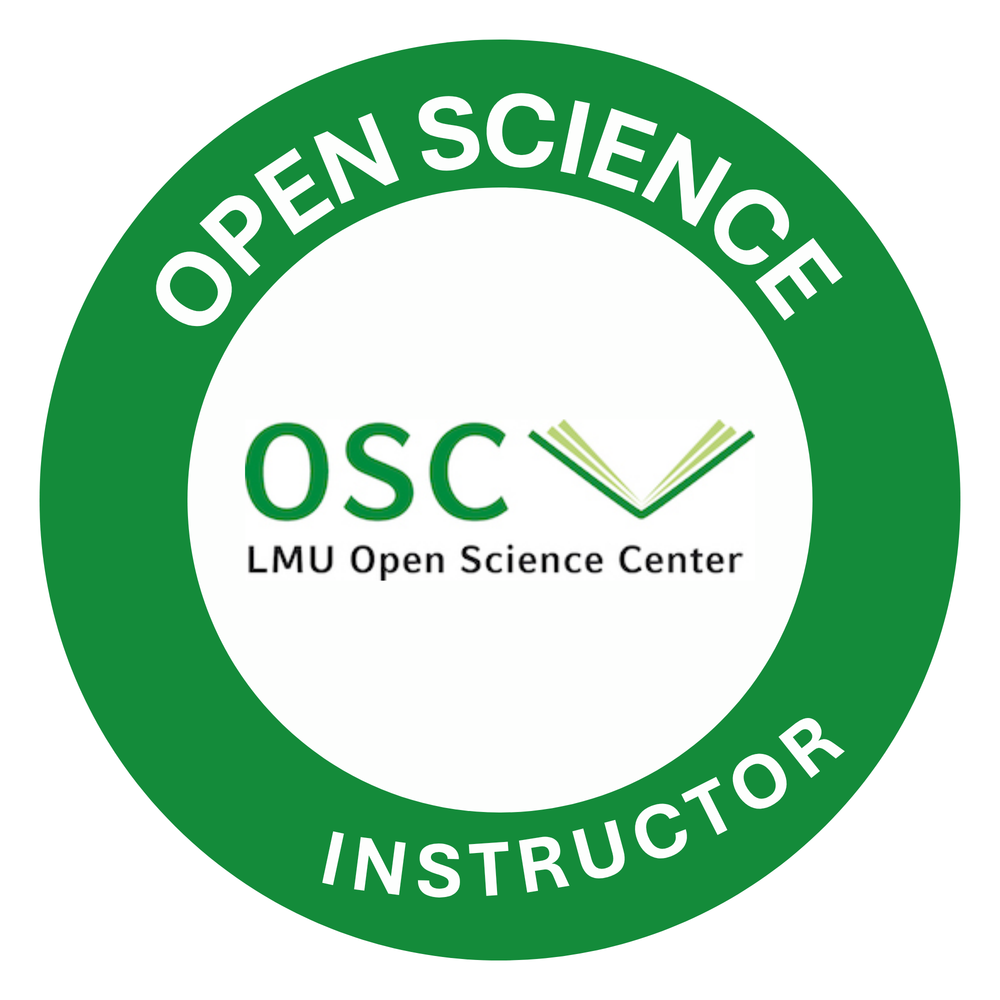
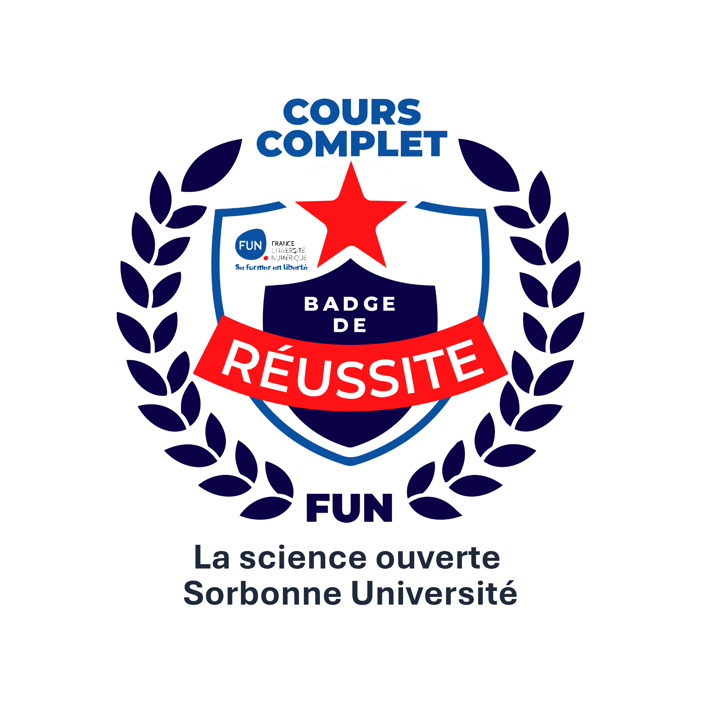
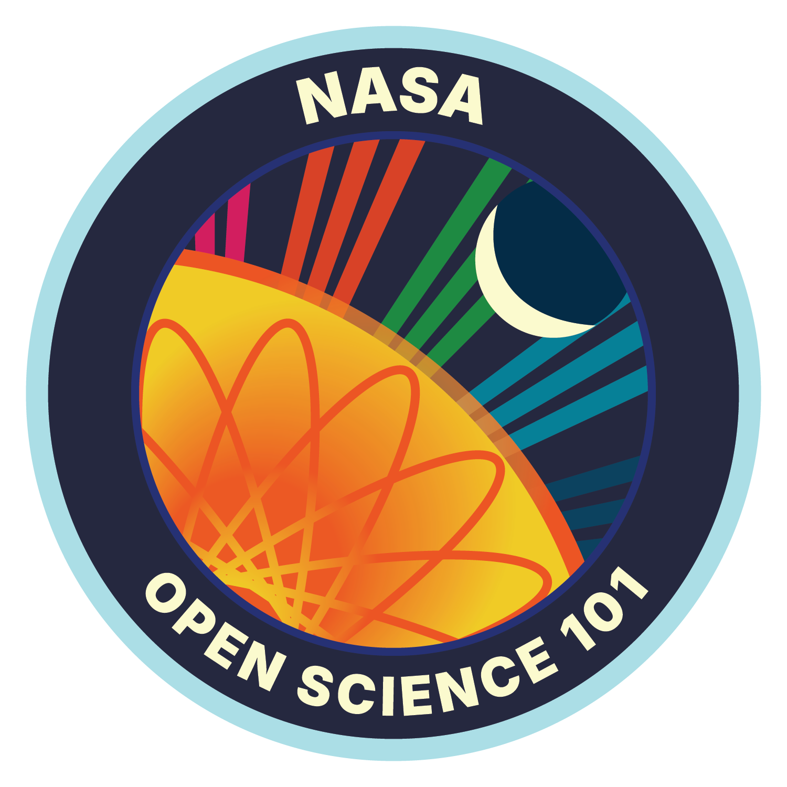
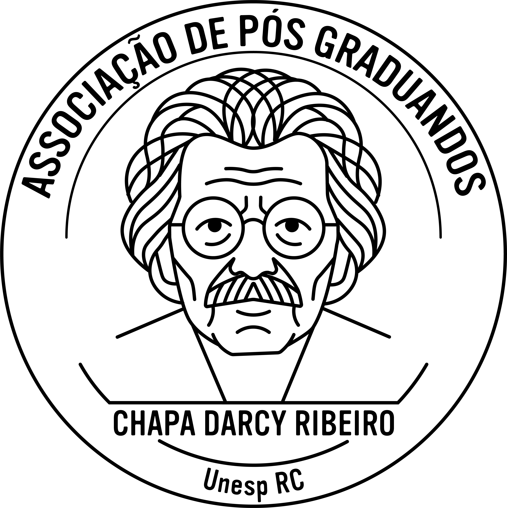
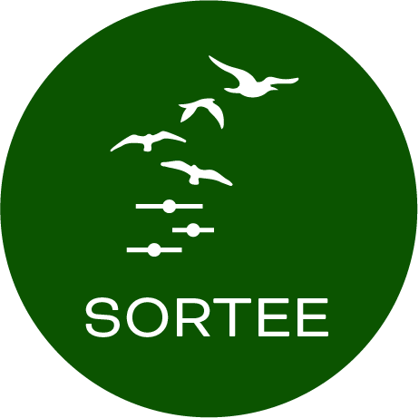
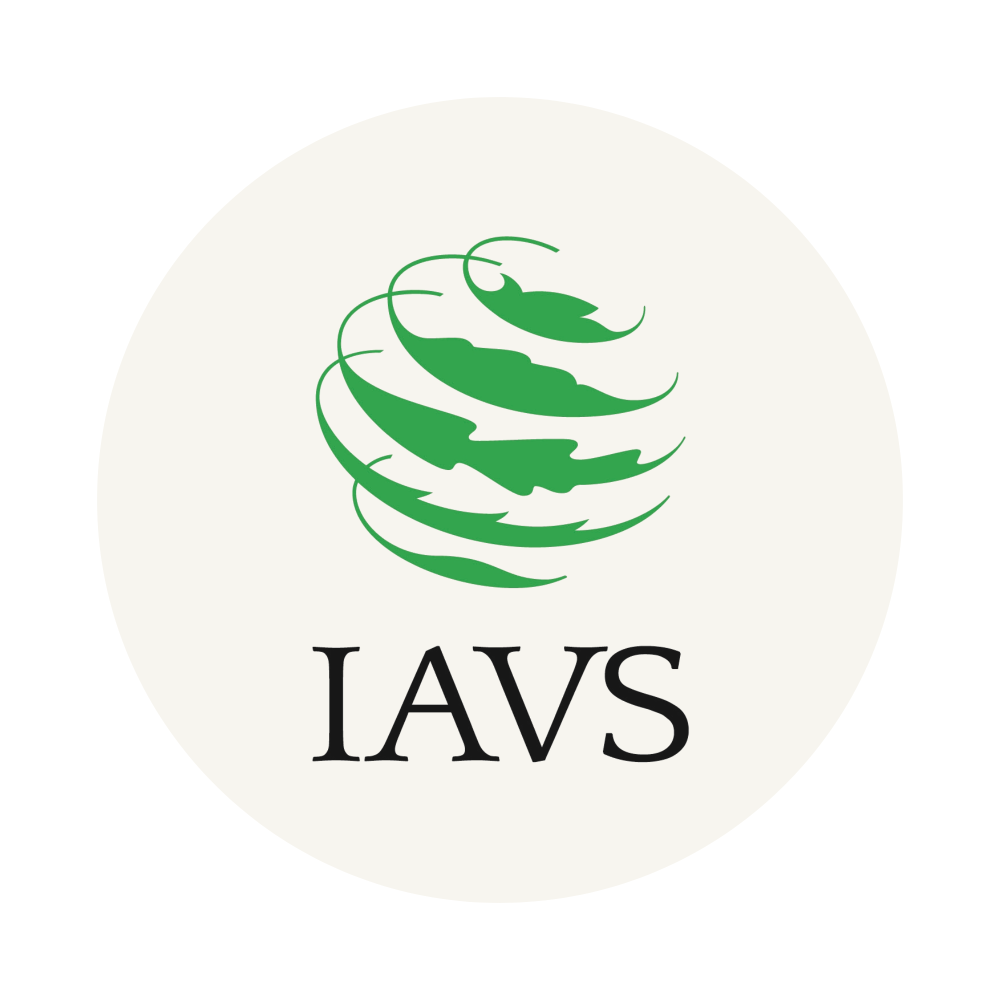

```{=html}
<link
  href="https://fonts.googleapis.com/css2?family=Manrope:wght@400;500;600;700&display=swap"
  rel="stylesheet">

<style>/* Composição geral */
.science-together {
  --st-ink: #59402e;
  --st-muted: #70513e;
  --st-line: #916c52;

  width: 100%;
  max-width: 1320px;
  box-sizing: border-box;
  margin: 0 auto;
  padding: 3.5rem 2rem 4rem;

  display: grid;
  grid-template-columns: minmax(0, 1fr) minmax(0, 1.08fr);
  align-items: center;
  gap: clamp(2rem, 4vw, 4.5rem);

  font-family: "Manrope", "Segoe UI", sans-serif;
  color: var(--st-ink);
}

/* Texto */
.science-together .st-copy {
  width: 100%;
  max-width: 560px;
}

.science-together .st-eyebrow {
  margin: 0 0 1.4rem;
  color: var(--st-muted);
  font-size: 0.78rem;
  font-weight: 600;
  line-height: 1.5;
  letter-spacing: 0.12em;
  text-transform: uppercase;
}

.science-together .st-heading {
  max-width: none;
  margin: 0 0 1.7rem;
  padding: 0;
  border: 0;

  color: var(--st-ink);
  font-family: inherit;
  font-size: clamp(2.5rem, 3.3vw, 3.65rem);
  font-weight: 500;
  line-height: 1.14;
  letter-spacing: -0.045em;
}

/* O título volta a quebrar naturalmente */
.science-together .st-heading span {
  display: inline;
}

.science-together .st-intro {
  max-width: 42ch;
  margin: 0;
  color: var(--st-muted);
  font-size: 1.12rem;
  font-weight: 400;
  line-height: 1.75;
  text-wrap: pretty;
  font-family: "Aptos", "Segoe UI", sans-serif;
}

.science-together .st-hint {
  margin: 1.5rem 0 0;
  color: var(--st-muted);
  font-size: 0.86rem;
  line-height: 1.6;
}

/* Constelação */
.science-together .st-network {
  position: relative;
  width: 100%;
  max-width: 640px;
  aspect-ratio: 600 / 660;
  margin: 0 auto;
  isolation: isolate;
}

.science-together .st-connections {
  position: absolute;
  inset: 0;
  width: 100%;
  height: 100%;
  z-index: 0;
  pointer-events: none;
}

.science-together .st-connections path {
  fill: none;
  stroke: var(--st-line);
  stroke-width: 1.8;
  stroke-linecap: round;
  opacity: 0.9;
}

/*
  Badges maiores.
  Compensa a nova largura para manter os centros
  alinhados às conexões do SVG.
*/
.science-together .st-node {
  position: absolute;
  left: var(--x);
  top: calc(var(--y) - 1.818%);
  width: 28%;
  margin: 0;
  transform: translateX(-50%);
  z-index: 1;
}

.science-together .st-badge-frame {
  display: grid;
  place-items: center;
  width: 100%;
  aspect-ratio: 1;
}

.science-together .st-node img {
  display: block;
  width: 94%;
  height: auto;
  max-width: 100%;
  max-height: 100%;
  object-fit: contain;
}

/* Remove as legendas visuais */
.science-together .st-node figcaption {
  display: none;
}

/* Posições dos badges */
.science-together .st-instructor {
  --x: 25%;
  --y: 3%;
}

.science-together .st-course {
  --x: 74%;
  --y: 12%;
}

.science-together .st-nasa {
  --x: 16%;
  --y: 35%;
}

.science-together .st-association {
  --x: 80%;
  --y: 44%;
}

.science-together .st-sortee {
  --x: 34%;
  --y: 68%;
}

.science-together .st-iavs {
  --x: 72%;
  --y: 76%;
}

/* Interação — para os badges que já tiverem links */
.science-together .st-badge-link {
  text-decoration: none;
  border: 0;
  border-radius: 50%;
}

.science-together .st-badge-link img {
  transition:
    transform 180ms ease,
    filter 180ms ease;
}

.science-together .st-badge-link:hover img,
.science-together .st-badge-link:focus-visible img {
  transform: translateY(-4px) scale(1.04);
  filter: drop-shadow(0 5px 7px rgb(89 68 56 / 16%));
}

.science-together .st-badge-link:focus-visible {
  outline: 2px solid #805c44;
  outline-offset: 5px;
}

/* Texto e constelação empilhados */
@media (max-width: 900px) {
  .science-together {
    grid-template-columns: 1fr;
    gap: 2.5rem;
    padding: 2.5rem 1.5rem 3rem;
  }

  .science-together .st-copy {
    max-width: 600px;
    margin-inline: auto;
  }

  .science-together .st-heading {
    font-size: clamp(2.5rem, 6vw, 3.5rem);
  }

  .science-together .st-network {
    max-width: 600px;
  }
}

/* Celulares estreitos */
@media (max-width: 480px) {
  .science-together {
    padding-inline: 1rem;
  }

  .science-together .st-heading {
    font-size: 2.4rem;
    line-height: 1.16;
    letter-spacing: -0.035em;
  }

  .science-together .st-intro {
    font-size: 1.05rem;
    line-height: 1.7;
  }

  .science-together .st-network {
    display: grid;
    grid-template-columns: repeat(2, minmax(0, 1fr));
    gap: 1.75rem 1rem;
    aspect-ratio: auto;
  }

  .science-together .st-connections {
    display: none;
  }

  .science-together .st-node {
    position: static;
    width: 100%;
    transform: none;
  }

  .science-together .st-badge-frame {
    max-width: 155px;
    margin-inline: auto;
  }
}

@media (prefers-reduced-motion: reduce) {
  .science-together .st-badge-link img {
    transition: none;
  }

  .science-together .st-badge-link:hover img,
  .science-together .st-badge-link:focus-visible img {
    transform: none;
  }
}

</style>

<section class="science-together" aria-labelledby="together-heading">

  <div class="st-copy">
    <p class="st-eyebrow">Building science together</p>

   <h1 id="together-heading" class="st-heading">
  What does it mean to build science together?
</h1>

    <p class="st-intro">
      For me, the answer takes shape through learning, teaching, 
      sharing, and working with others. Here are some of the 
      experiences and communities helping me find my way.
    </p>

  </div>

  <div class="st-network"
       role="group"
       aria-label="Experiences and communities shaping my journey">

 <svg class="st-connections"
     viewBox="0 0 600 660"
     aria-hidden="true"
     focusable="false">

  <!-- Instructor → Sorbonne -->
  <path d="M 150 92
           C 250 50, 345 78, 444 151" />

  <!-- Instructor → NASA -->
  <path d="M 150 92
           C 182 172, 176 230, 96 303" />

  <!-- NASA → Association -->
  <path d="M 96 303
           C 235 265, 340 310, 480 363" />

  <!-- Sorbonne → SORTEE -->
  <path d="M 444 151
           C 285 235, 330 395, 204 521" />

  <!-- Association → IAVS -->
  <path d="M 480 363
           C 531 445, 493 509, 432 574" />

  <!-- SORTEE → IAVS -->
  <path d="M 204 521
           C 281 485, 344 605, 432 574" />

</svg>

   <figure class="st-node st-instructor">
  <a
    class="st-badge-frame st-badge-link"
    href="#open-science-instructor"
    aria-label="Read about my Open Science Instructor experience">

    

  </a>
</figure>

   <figure class="st-node st-course">
  <a
    class="st-badge-frame st-badge-link"
    href="#la-science-ouverte"
    aria-label="Read about my experience with La science ouverte">

    

  </a>
</figure>

<figure class="st-node st-nasa">
  <a
    class="st-badge-frame st-badge-link"
    href="#open-science-101"
    aria-label="Read about my experience with Open Science 101">

    

  </a>
</figure>

<figure class="st-node st-association">
  <a
    class="st-badge-frame st-badge-link"
    href="#student-community"
    aria-label="Read about my involvement in the graduate student community">

    

  </a>
</figure>

<figure class="st-node st-sortee">
  <a
    class="st-badge-frame st-badge-link"
    href="#sortee"
    aria-label="Read about my experience with SORTEE">

    

  </a>
</figure>

<figure class="st-node st-iavs">
  <a
    class="st-badge-frame st-badge-link"
    href="#iavs"
    aria-label="Read about my experience with the IAVS Social Media Committee">

    

</a>
</figure>
  </div>
</section>

```

## Open Science Instructor {#open-science-instructor}


## Open Science 101 {#open-science-101}


## La science ouverte {#la-science-ouverte}


## SORTEE {#sortee}


## Graduate student community {#student-community}


## IAVS Social Media Committee {#iavs}
