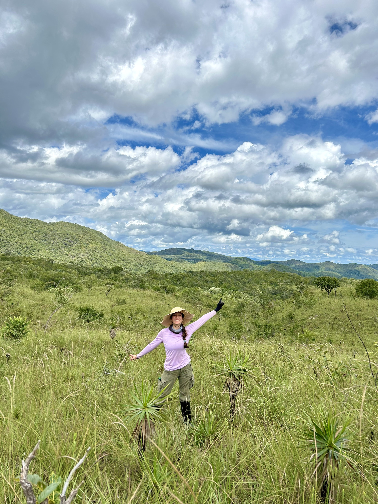

:::: {.hero-grid}

::: {.hero-photo}

{.hero-image fig-alt="That's me being extremely happy in the field"}

```{=html}
<link rel="stylesheet" href="https://cdnjs.cloudflare.com/ajax/libs/font-awesome/6.7.2/css/all.min.css">
<nav class="profile-links" aria-label="Academic and social profiles">

  <a href="mailto:gabriela.dezotti@unesp.br"
     aria-label="Email" title="Email">
    <i class="fa-solid fa-envelope" aria-hidden="true"></i>
  </a>

  <a href="[https://scholar.google.com/citations?hl=en&user=_fw31_MAAAAJ](https://scholar.google.com/citations?hl=en&user=_fw31_MAAAAJ)"
     aria-label="Google Scholar" title="Google Scholar">
    <i class="fa-brands fa-google-scholar" aria-hidden="true"></i>
  </a>

  <a href="[https://orcid.org/0000-0003-4390-2699](https://orcid.org/0000-0003-4390-2699)"
     aria-label="ORCID" title="ORCID">
    <i class="fa-brands fa-orcid" aria-hidden="true"></i>
  </a>

  <a href="[https://github.com/gabrieladezotti](https://github.com/gabrieladezotti)"
     aria-label="GitHub" title="GitHub">
    <i class="fa-brands fa-github" aria-hidden="true"></i>
  </a>

  <a href="[https://bsky.app/profile/gabrieladezotti.bsky.social](https://bsky.app/profile/gabrieladezotti.bsky.social)"
     aria-label="Bluesky" title="Bluesky">
    <i class="fa-brands fa-bluesky" aria-hidden="true"></i>
  </a>

</nav>
```

:::

::: {.hero-text}

```{=html}
<h1 class="home-greeting">
  Hi, I’m Gabriela! <span class="home-pronouns">(she/her)</span>
</h1>
```

I’m a PhD candidate in Ecology, Evolution and Biodiversity at [Universidade Estadual Paulista (UNESP)](https://ib.rc.unesp.br/), in Rio Claro, Brazil. I’m part of the [BioMe Group](https://tsiqueiralab.weebly.com/), where I work with [Tadeu Siqueira](https://scholar.google.com/citations?user=T0QGyQIAAAAJ&hl=en).

I’m a work-in-progress ecologist, curious about how disturbances shape biodiversity and what happens when disturbance regimes change. Most of my work has grown out of fire-modulated ecosystems, but my questions keep taking me beyond fire.

I also spend a lot of time thinking about how we do science, how we document our work, share what we learn, and make it easier for others to build on it. Open science and FAIR data practices are a big part of that.

Teaching is another part of this that means a lot to me. I’m now an instructor, and I want to help make learning feel welcoming: somewhere there’s room for questions, for trying things out, and for figuring things out together.

You can read more about my path in [About](about.qmd), explore my research in [Projects](projects.qmd), or find some of what I share in [Outreach](outreach.qmd).

And if you’d like to talk ecology, open science, or something you’re learning, I’d be happy to hear from you, just [say hello](mailto:gabriela.dezotti@unesp.br)!

:::
::::